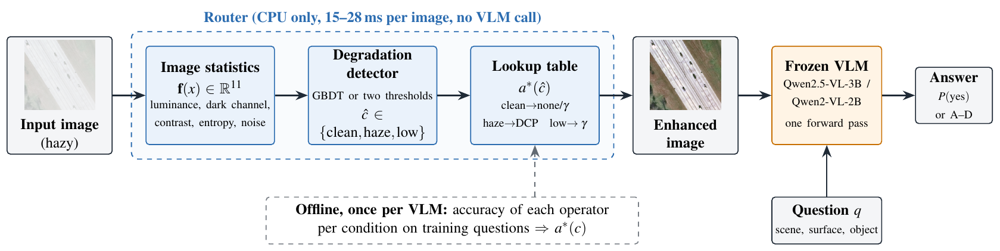

# Detect, Then Enhance

**Lightweight degradation-aware enhancement routing for frozen remote-sensing vision-language models**

Code, router models, and every scored VLM run for the paper

> S. M. H. Tauqeer, M. Talha, H. Ghafoor, and S. Y. Nam, "Detect, Then Enhance: Lightweight Degradation-Aware
> Enhancement Routing for Frozen Remote-Sensing Vision-Language Models," submitted to *IEEE Journal of Selected
> Topics in Applied Earth Observations and Remote Sensing*, 2026.



Hazy or underexposed images change what a vision-language model (VLM) answers, but enhancing every image is not a safe
fix: each enhancement helps one degradation and hurts others. The router computes 11 global statistics of the input
image, detects the degradation (clean, haze, or low light), and applies the operator that worked best for that
degradation (none, CLAHE, adaptive gamma, or dark-channel dehazing). It runs on a CPU in 15-28 ms per image, never calls
the VLM, and never fine-tunes it.

## Main results

| Setting | VLM | Never enhance | Router | Note |
|---|---|---|---|---|
| UC Merced, synthetic haze and low light (5-fold CV) | Qwen2.5-VL-3B | 79.6% | **83.3%** | matches the condition oracle |
| | Qwen2-VL-2B | 85.2% | **86.2%** | |
| AID, router fitted on UC Merced | Qwen2.5-VL-3B / Qwen2-VL-2B | 78.8% / 82.4% | **81.3% / 83.3%** | ties the best fixed operator |
| Unseen stronger degradation (level 4) | Qwen2.5-VL-3B / Qwen2-VL-2B | 67.4% / 75.3% | **76.3% / 78.8%** | |
| RRSHID real haze, detector + 30 real pairs | Qwen2.5-VL-3B / Qwen2-VL-2B | 85.9% / 84.0% | **89.1% / 90.0%** | oracle on hazy inputs |
| CODrone real night and day | Qwen2.5-VL-3B / Qwen2-VL-2B | 70.0% / 69.7% | 69.2% / 70.9%* | enhancement matters little at night |

\*two-threshold detector. Full tables, confidence intervals, and the cases where the router does not help are in the
paper and in `results/`.

## Repository layout

```
configs/experiments.yaml   every setting used in the paper (models, prompts, seeds, degradations, enhancers, router)
src/                       code (see table below)
scripts/                   one script per experiment, plus 06 (all tables from stored runs, CPU) and 07 (figures)
models/                    fitted router: detectors, thresholds, lookup tables, metadata
results/                   every scored VLM run, questions, image statistics, reports, original Kaggle logs
figures/                   paper figures and the TikZ source of the pipeline diagram
docs/REPRODUCIBILITY.md    software versions, seeds, settings, run times, known differences
docs/PROJECT_NOTES.md      full project history and context for future revisions
```

| File | Purpose |
|---|---|
| `src/common.py` | Degradations (haze, low light, severities 1-4), enhancement operators, image statistics |
| `src/prepare_ucm_ml.py`, `prepare_aid.py` | Question sets for UC Merced multi-label and AID |
| `src/prepare_rrshid.py`, `prepare_codrone.py` | Real-haze (RRSHID) and real-night (CODrone) test sets |
| `src/make_versions.py` | Degraded and enhanced versions of every image, with cached statistics |
| `src/run_vlm.py` | Generation-free scoring from first-token probabilities; resumable; multi-GPU sharding |
| `src/analyze_pilot.py` | Main study: fixed policies, per-sample gate, router with 5-fold CV, help/hurt analysis |
| `src/main_table_ci.py` | Main-study table with image-level bootstrap intervals, threshold router, cross-VLM table |
| `src/transfer_eval.py` | Router fitted on UC Merced and applied unchanged to a new set (`--pseudo`, `--extra_det`) |
| `src/fewshot_rrshid.py` | Labelled RRSHID training pairs for the few-shot detector |
| `src/export_router.py`, `src/route.py` | Save the router; apply it to any image |
| `src/make_figures.py`, `make_fig_examples.py`, `make_fig_real.py` | Paper figures |

## Quick start

```bash
git clone https://github.com/Electromind18/detect-then-enhance.git
cd detect-then-enhance
pip install -r requirements.txt

# 1) recompute every table of the paper from the stored runs (CPU, a few minutes)
bash scripts/06_tables_from_saved_runs.sh

# 2) route your own image
cd src
python route.py --image my_scene.png --vlm Qwen2.5-VL-3B-Instruct --save my_scene_enhanced.png
```

To re-run the VLMs, run `scripts/01_main_study.sh` first and then `02` to `05` (two GPUs; times and details in
`docs/REPRODUCIBILITY.md`).

## Data

No images are redistributed. UC Merced multi-label and AID are loaded from Hugging Face; RRSHID and CODrone are
downloaded from the links published by their authors, and their licences apply. The `results/` files contain only
questions, answers, model probabilities, and image statistics.

## Citation

See `CITATION.cff`. Please cite the paper if you use this code or the stored results.

## Licence

MIT (see `LICENSE`).
